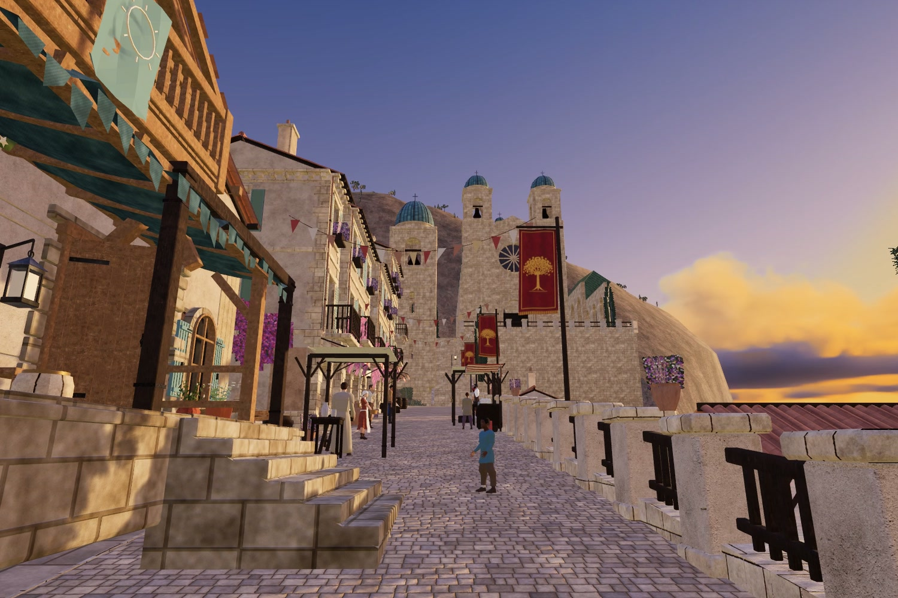
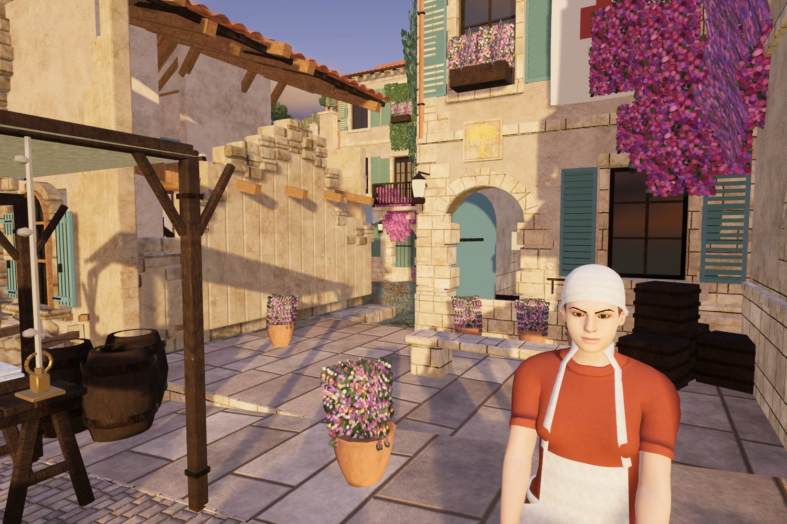
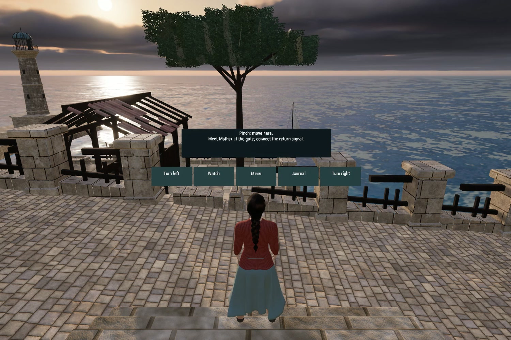
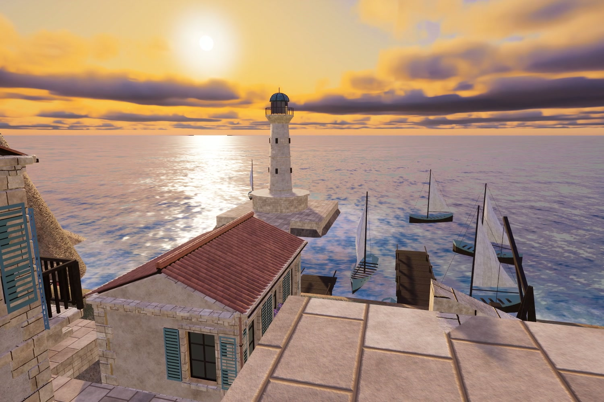
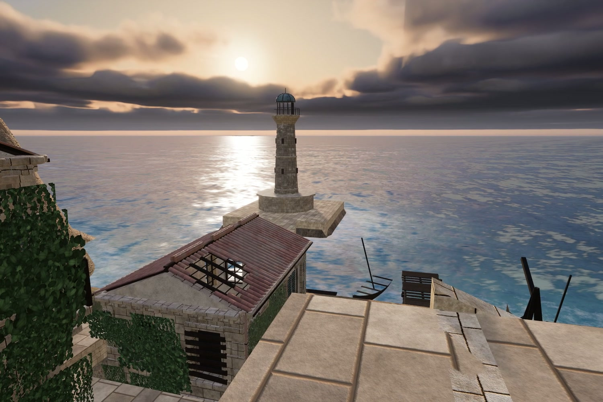

# The Other Side of Yesterday

The watch on your wrist can turn back twenty years. Pinch its hand, turn it, and step into the city before the war.
A seated story for Meta Quest, played with your hands alone.

Entry for the Meta VR Start Developer Competition 2026. Track: Gaming. Division: Adapted / Significantly Updated
Experience.

## What it is

Verdant is a coastal town twenty years after a war. You are a watchmaker's child who has spent five years repairing
the Chronowatch in the surviving half of the family home.

- **Chapter I.** Your mother, a photograph that comes to your hand, an unsent letter, the last calibration at the
  workbench. Once the watch is calibrated its dial is on your wrist. Raise your wrist, pinch the dial, carry its hand
  round to BEFORE THE WAR, and step into the living city.
- **Chapter II.** The city before the storm, and one sheet of canvas that two places need. You choose, put it up, come
  home, and read what your choice changed.

The demo takes about ten minutes.

## How to play

Sit down. No controllers are needed.

1. The title panel is in front of you. Point at Select and pinch to start a New Game.
2. Memories play; pinch with your other hand, or the Back button, to skip them.
3. In the room, look at something and pinch to use it. Start with the photograph, the letter, then Mother.
4. In a conversation, pinch to continue. When replies appear, point at one and pinch.
5. The row under your view has Turn left, Watch, Menu, Journal, Turn right. Pinch a disc on the floor to move there.
6. At the workbench, place the part and run the test twice. The watch's dial is now on the wrist of your other hand.
7. Go to the gate. Raise your wrist and pinch the dial (or pinch the Watch button). Pinch the watch hand, carry it to
   the left mark (BEFORE THE WAR), let go, and pinch Select.
8. Chapter I ends as the city before the war fades in. Chapter II continues from there.

Hold a pinch with your other hand for one second to pause. The pause panel has Save, Load, Recenter, Gaze select, Main
hand and Large text. If pinching is not detected, Gaze select lets you choose by looking at a button for about 1.5
seconds.

## Accessibility

Seated, nothing to reach for, no smooth locomotion. Either hand: your first pinch decides the main hand. One hand is
enough for every step. If no hand is tracked, look-to-select switches itself on. Large text enlarges every panel by 30
percent.

## The build

The playable build is an Android APK for Meta Quest 3 and 3S (version code 15, `0.3.0-competition`). It is attached
to this repository's **Releases** page.

The competition entry itself is the same build in the "Competition" release channel on the Meta Horizon Developer
Dashboard; judges should use the link on the Devpost page.

## How it was built

Unreal Engine 5.8 with the OpenXR hand tracking that ships with it, and no third-party SDK. The player reads all 25
joints of each hand, draws the hands from them, and places the watch on your wrist from the joint positions. A pinch is
the thumb-to-index distance with hysteresis. Pointing is a ray from your eye through your fingertip, latched as the
pinch forms so the target never jumps. The two-era town comes from a Blender pipeline.

## What has and has not been tested

There was no Quest headset during development. A scripted player with simulated hands plays all four story routes by
pinch alone, with two hands and again with the left hand only, and about 3,000 automated checks run on every build. In
Meta XR Simulator, real OpenXR hand data drew the hands, and pinches drove the menu, skip, pause and resume.

**The build has not been run on a device.** The screenshots here and the trailer are PC captures of the Quest build.

## Screenshots

| | |
|---|---|
|  |  |
|  |  |
|  |  |
|  |  |

## Source

The whole game project is in this repository.

| Path | What it is |
|---|---|
| `game_unreal/` | The Unreal Engine 5.8 project: `YesterdayHarbor.uproject`, `Config/`, `Content/` (about 1 GB of assets), `Source/` (C++), `Python/` (the scripts that author the Blueprints, maps and tests), `ContentData/` (dialogue and story data), `Plugins/YesterdaySaveGuard/` (save-file plugin source) |
| `verdant/` | The Blender pipeline that builds the two-era city |
| `tools/` | Build, packaging, APK inspection, capture and trailer tools |
| `*.py` at the top level | Blender scripts for the house, harbour, props and characters |
| `native_save_guard/`, `tests/`, `assets/` | Plugin notes and audit, a contract test, a reference material |
| `media/` | Screenshots for this page |

To open it: install Unreal Engine 5.8, open `game_unreal/YesterdayHarbor.uproject` and let the editor build the C++
modules. The Quest build needs the Android SDK, NDK and JDK that Unreal 5.8 asks for.

Not included: build output (`Binaries`, `Intermediate`, `Saved`), the packaged builds (see Releases), the recorded test
evidence and captures (about 16 GB), and the working notes. Scripts contain absolute Windows paths from the machine
they were written on, with the user folder written as `C:\Users\USER`; change them to your own checkout. The same
replacement was made inside the asset files' import paths in this copy.

## Third-party content

- Surfaces and sky from [Poly Haven](https://polyhaven.com), CC0.
- Human figures exported from MakeHuman Community / MPFB assets, CC0.
- Unreal Engine template content and character animation from Epic Games (the mannequins and the first-person,
  third-person and XR template assets), under the Unreal Engine EULA.
- The family photograph is an AI-assisted image of a fictional character.

## Rights

Everything else is the author's own work. All rights reserved.
